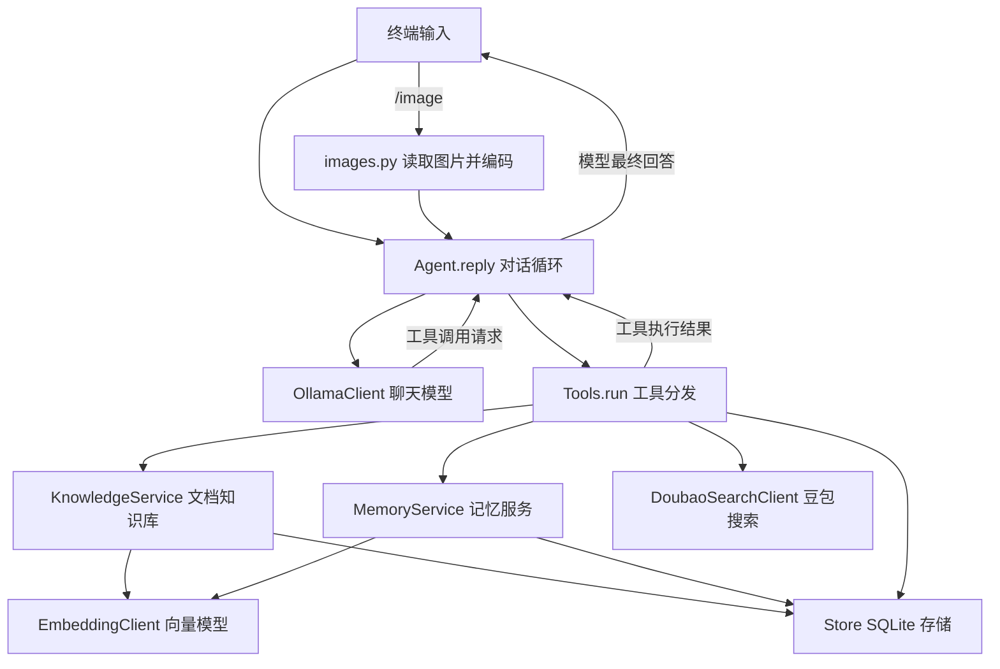
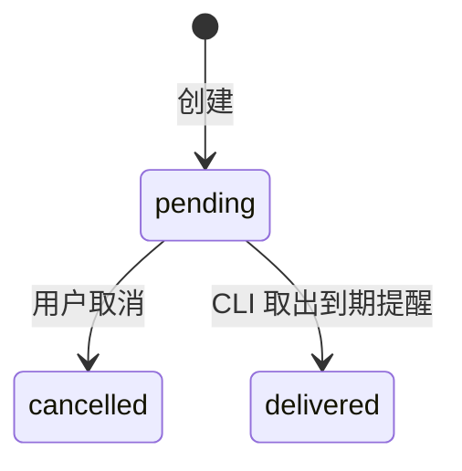

> 历史文档：截至 2026-11-02 移除个人记忆功能之前的规划及验收记录。文中的旧记忆工具和命令已停用，当前实现请阅读 [Phase 1 文档](phase1.md)。

# JARVIS-M1 Phase 1 落地规划

本文包含项目范围、验收记录和当前源码的实现说明。初次阅读可直接进入 [代码讲解](#代码讲解)。

## 目标与依据

依据聊天中 **JARVIS-M1 · Phase 1：纯软件 AI 管家** 的规划，以当前 TableBot 目录中的源码为起点，
在 WSL Ubuntu + RTX 5070 Ti 上跑通软件闭环。

本阶段采用单进程、模块化设计，不引入 LangGraph、向量数据库或 MCP Server。
先验证真实模型的工具调用，再扩展低延迟语音、Memory V2、Web Dashboard 和机器人技能。

## 模块与验收

| 模块 | 当前文件 | 验收标准 |
| --- | --- | --- |
| LLM Engine | `jarvis/llm.py` | 本地 Ollama 能完成中文对话，服务故障时显示错误 |
| Agent Core | `jarvis/agent.py` | 模型选择工具，执行后读取结果并回应；调用次数有上限 |
| Memory / RAG | `jarvis/storage.py`、`jarvis/memory.py`、`jarvis/embeddings.py` | 明确要求后保存，纯向量语义检索；按 user_id 隔离；重启后保留；删除同步清理索引 |
| Markdown 知识库 | `jarvis/knowledge.py` | 读取 knowledge/，切块并增量同步，纯向量检索后引用原文件与行号 |
| 图片输入 | `jarvis/images.py` | 本地 PNG/JPEG 图文输入，支持 Windows 路径和会话内追问 |
| Web Search | `jarvis/tools.py`、`jarvis/search.py` | 使用豆包搜索 Custom，配置搜索 Key 后返回来源与内容；未配置时明确说明不可用 |
| Reminder | `jarvis/storage.py`、`jarvis/tools.py` | 创建、查询、取消；拒绝无时区或过去时间；以 UTC 存储 |
| CLI | `jarvis/__main__.py` | 中文输入、命令管理、错误显示、退出正常 |
| WSL 入口 | `wsl.ps1`、`scripts/wsl.sh` | 当前 Windows 目录直接启动 WSL Python；无需复制另一份源码 |
| 环境自检 | `jarvis/doctor.py` | 检查 Ollama 连通性、模型是否下载、时区；失败返回非零退出码 |
| 自动测试 | `tests/test_*.py` | 无网络测试覆盖 Agent 恢复、LLM 请求、存储、RAG 与豆包搜索协议和错误处理 |
| 真实模型验收 | `jarvis/smoke.py` | 实际模型完成聊天、记忆和提醒工具循环；临时数据不写入用户数据库 |
| 真实 RAG 验收 | `jarvis/rag_smoke.py` | 实际 embedding 验证同义查询、无关查询、用户隔离、删除索引和新会话回答 |
| 真实搜索验收 | `jarvis/search.py` 的 `check_search()` | 单独调用一次豆包搜索，验证 Key、服务权限及实际响应；不需要聊天模型 |

提醒的“完成”范围是 **持久化 + CLI 检查**，不是后台调度和离线通知。
搜索的真实结果验收需要用户自己的豆包搜索 Key；没有 Key 时只能验收缺失配置的不可用处理。

## 实施顺序

1. **运行环境**：确认 WSL2、Python、GPU，安装并启动 Ollama，下载规划指定模型。
2. **Agent + Memory + Tools**：先跑单元测试，再运行真实模型验收；检查真实数据库状态，避免只根据模型话术判断成功。
3. **CLI 手动验收**：按 README 操作，检查跨进程持久化、中文交互和时区行为。
4. **联网搜索**：填入 `DOUBAO_SEARCH_API_KEY`，先运行 `search-test`，再验证模型使用实时结果与引用 URL 的表现。
5. **Phase 1 收口**：记录实际测试结果、未覆盖事项和模型局限，再开始下一模块。

## 后续模块

- Voice Service：Wake Word、VAD、ASR、TTS、打断与延迟测量。
- Memory V2：结构化画像、更新机制、授权确认和家庭成员身份识别。
- Web Dashboard：聊天、工具日志、记忆与提醒管理。
- Robot Skills：通过独立技能接口接入 ROS 2 和硬件控制，保持模型与执行机构解耦。

后续模块不作为当前 Phase 1 的完成条件。

## 本机初始验收记录（2026-11-01）

- 环境：WSL2 Ubuntu 24.04.3、Python 3.12.3、Ollama 0.40.13。
- GPU：RTX 5070 Ti 16GB；Ollama 显示 `100% GPU`，33/33 层已卸载到 GPU。
- 初始模型：聊天 `qwen3.5:4b`，记忆向量 `qwen3-embedding:0.6b`；服务监听 `127.0.0.1:11434`。聊天模型后续升级为 `qwen3.5:9b`，详见文末升级记录。
- 当前单元测试：101 项全部通过，覆盖现有功能、目录知识库，以及图片输入和图文历史管理。
- 真实模型：中文对话、记忆保存/查询/删除、提醒创建/查询/取消全部通过；检查了实际数据库状态及提醒对应的时间点。
- 缺少搜索 Key 时：模型确实调用搜索工具，并告知搜索不可用。
- 观察到首次冷启动对话约 51 秒（含模型加载）；后续本轮测试每条约 0.8–1.7 秒。这是单机单次观察，不是稳定性或性能保证。
- 豆包联网搜索：已配置 Key，并完成独立接口与本地模型工具调用的真实验收，详见文末记录。
- 未验收：长期运行、多种自然语言问法的工具选择稳定性，以及不同主题和时效要求下的搜索质量。

结论：本地聊天、记忆、提醒和豆包搜索的基本调用链已在 WSL 实机跑通；持续运行及检索质量仍需扩展验收。

## 记忆 RAG 扩展（2026-11-01）

已在 WSL 加入轻量记忆 RAG：原文与向量存放在 SQLite，向量由本地 Ollama 生成。按用户要求，检索仅采用向量语义相似度。
在新会话中，由模型通过 `search_memory` 获取相关记忆再回答。写入仍沿用明确要求保存的提示词规则。

候选仅按余弦相似度筛选和排序，不使用文字匹配加权，也不在向量服务故障时回退到文字检索。
检索错误通过工具的 `error` 字段告知模型；空查询需要补充问题或主题。`/memories` 保留为直接查看记录的管理命令。

真实向量测试中，三个无完整查询字面匹配的问法均正确找回对应记忆：

| 问题 | 找回的记忆 | 余弦相似度（单次观察） |
| --- | --- | --- |
| 照明上有什么喜好？ | 喜欢暖黄色灯光，不喜欢刺眼的冷白光 | 0.6053 |
| 喜欢哪一种戏曲？ | 喜欢京剧，尤其是《贵妃醉酒》 | 0.7163 |
| 孩子在哪座城市生活？ | 女儿小林住在大阪 | 0.5426 |

真实聊天模型在没有此前对话的情况下，通过检索正确回答了照明偏好；删除后对应记忆不再出现在检索结果中。
这些示例验证实现可用，不代表对所有问法和主题都可靠。个人记忆尚未实现自动偏好更新或冲突合并；目录文档由独立的 [Markdown 知识库](knowledge-base.md) 模块处理。

## 代码讲解

本节对应 2026-11-01 的当前实现，按“启动 → 对话 → 工具 → 记忆 → 测试”的顺序阅读。
文中的示例用于说明调用和数据格式，不代表用户数据库中实际存在这些记录。

### 1. 程序由哪些部分组成

整个应用是一个 Python CLI 进程，通过 HTTP 调用 WSL 中独立运行的 Ollama 服务。
聊天模型负责理解问题、选择工具和组织回答；向量模型负责把文字转换成用于检索的数字向量。
Python 代码负责真正执行工具、访问数据库和处理错误。



默认模型分工：

| 组件 | 默认配置 | 任务 |
| --- | --- | --- |
| 聊天模型 | `qwen3.5:9b` | 中文对话、生成工具调用、根据工具结果回答 |
| 向量模型 | `qwen3-embedding:0.6b` | 为记忆原文和查询问题生成向量 |
| SQLite | `data/jarvis.db` | 保存记忆原文、向量及提醒状态 |
| 豆包搜索 Custom | `DOUBAO_SEARCH_API_KEY` | 提供实时联网搜索结果，需要联网和搜索专用 Key |

个人记忆由外部数据库提供，聊天模型的权重不会因为保存偏好而改变。
当前 RAG 是“先检索已保存的个人记忆，再交给模型生成回答”。每条短记忆就是一个检索单元。

### 2. 文件与职责

| 文件 | 主要对象或入口 | 职责 |
| --- | --- | --- |
| [wsl.ps1](../wsl.ps1) | `-Action` | 从 PowerShell 进入 Ubuntu，转交操作 |
| [scripts/wsl.sh](../scripts/wsl.sh) | `case` 分支 | 固定工作目录、准备配置、选择启动或测试入口 |
| [jarvis/__main__.py](../jarvis/__main__.py) | `main()` | 组装对象，执行 CLI 命令和对话 |
| [jarvis/config.py](../jarvis/config.py) | `load_env()` | 加载 `.env` 与环境变量 |
| [jarvis/agent.py](../jarvis/agent.py) | `Agent` | 管理消息上下文和工具调用循环 |
| [jarvis/llm.py](../jarvis/llm.py) | `OllamaClient` | 调用 Ollama `/api/chat` |
| [jarvis/tools.py](../jarvis/tools.py) | `TOOL_SCHEMAS`、`Tools` | 向模型描述工具，并执行对应 Python 逻辑 |
| [jarvis/search.py](../jarvis/search.py) | `DoubaoSearchClient`、`check_search()` | 请求豆包搜索，整理来源结果，处理服务错误和真实搜索验收 |
| `jarvis/memory.py`（已移除） | `MemoryService` | 记忆保存、索引建立、纯向量语义检索 |
| [jarvis/knowledge.py](../jarvis/knowledge.py) | `KnowledgeService`、`chunk_markdown()` | 扫描 Markdown、按标题切块、增量同步、返回文件来源片段 |
| [jarvis/images.py](../jarvis/images.py) | `parse_image_command()`、`load_images()` | 解析图片命令、转换 WSL 路径、检查 PNG/JPEG 并编码 |
| [jarvis/embeddings.py](../jarvis/embeddings.py) | `EmbeddingClient`、`normalize()` | 调用 `/api/embed`，检查并归一化向量 |
| [jarvis/storage.py](../jarvis/storage.py) | `Store` | 创建表，读写 SQLite，管理提醒状态 |
| [jarvis/doctor.py](../jarvis/doctor.py) | `check()` | 检查时区、服务和模型是否就绪 |
| [jarvis/smoke.py](../jarvis/smoke.py) | `run()` | 使用真实模型验收聊天、记忆和提醒 |
| `jarvis/rag_smoke.py`（已移除） | `run()` | 验收语义检索与新会话中的记忆回答 |
| [jarvis/knowledge_smoke.py](../jarvis/knowledge_smoke.py) | `run()` | 真实文档检索、模型引用、编辑与删除同步验收 |
| [jarvis/vision_smoke.py](../jarvis/vision_smoke.py) | `run()` | 临时图形的真实识图与后续追问验收 |
| [tests/test_core.py](../tests/test_core.py) | `CoreTests` | 存储、提醒、工具循环的离线测试 |
| `tests/test_memory.py`（已移除） | `MemoryTests` | 检索、索引、用户隔离及异常场景的离线测试 |
| [tests/test_search.py](../tests/test_search.py) | `SearchTests` | 豆包搜索协议、时间过滤、来源整理和失败场景的离线测试 |
| [tests/test_agent.py](../tests/test_agent.py) | `EmptyReplyTests` | 空回复重试、搜索结果兜底、恢复中工具复用和完整轮次历史管理 |
| [tests/test_llm.py](../tests/test_llm.py) | `OllamaClientTests` | 显式模型参数、响应结构校验与截断诊断元信息 |
| [tests/test_knowledge.py](../tests/test_knowledge.py) | `KnowledgeTests`、`MarkdownChunkTests` | 目录同步、块引用、快照一致性、纯向量检索及异常处理 |
| [tests/test_images.py](../tests/test_images.py) | `ImageTests` | 图片路径与格式、CLI、多轮图文和图片数量限制 |

`requirements.txt` 当前只有说明性注释。应用使用 Python 标准库，Ollama 作为独立软件安装。

### 3. 从启动命令进入 Python

在当前目录的 PowerShell 输入：

```powershell
.\wsl.ps1
```

依次发生：

1. `wsl.ps1` 默认选择 `run`，使用脚本所在目录作为工作目录，启动 Ubuntu 中的 Bash。
2. `scripts/wsl.sh` 切换到项目根目录，避免从其他目录启动时找错配置或数据库。
3. 如果 `.env` 不存在，从 `.env.example` 复制；已有 `.env` 保留。
4. Bash 执行 `python3 -m jarvis`，Python 进入 `jarvis/__main__.py`。
5. `main()` 解析命令行，创建数据库、记忆服务、工具对象和 Agent，进入输入循环。

核心对象的组装代码如下：

```python
store = Store(config.DB_PATH)
memory = MemoryService(store, EmbeddingClient())
knowledge = KnowledgeService(store, EmbeddingClient(query_instruction=QUERY_INSTRUCTION))
agent = Agent(OllamaClient(), Tools(store, args.user, memory=memory, knowledge=knowledge))
```

这里把同一个 `store` 交给记忆和知识库服务，把两个服务交给工具，再把工具与聊天客户端交给 Agent。
这种写法允许测试时换成内存数据库、模拟模型和模拟向量服务。

PowerShell 操作与 Python 入口的对应关系：

| 命令 | 最终执行 | 用途 |
| --- | --- | --- |
| `.\wsl.ps1` | `python3 -m jarvis` | 聊天 |
| `.\wsl.ps1 -Action check` | `python3 -m jarvis --check` | 环境自检 |
| `.\wsl.ps1 -Action test` | `python3 -m unittest discover -s tests -v` | 单元测试 |
| `.\wsl.ps1 -Action smoke` | `python3 -m jarvis --smoke-test` | 真实模型功能验收 |
| `.\wsl.ps1 -Action rag-smoke` | `python3 -m jarvis.rag_smoke` | 真实 RAG 验收 |
| `.\wsl.ps1 -Action search-test` | `python3 -m jarvis --search-test` | 发起一次真实豆包搜索，消耗搜索额度 |
| `.\wsl.ps1 -Action index` | `python3 -m jarvis --reindex-memory` | 重建默认用户的记忆索引 |
| `.\wsl.ps1 -Action kb-index` | `python3 -m jarvis --reindex-knowledge` | 重建 Markdown 知识库索引 |
| `.\wsl.ps1 -Action kb-smoke` | `python3 -m jarvis.knowledge_smoke` | 真实知识库验收，使用临时资料 |
| `.\wsl.ps1 -Action vision-smoke` | `python3 -m jarvis.vision_smoke` | 真实图片识别及会话内追问 |
| `.\wsl.ps1 -Action pull` | 两次 `ollama pull` | 下载配置中的聊天模型与向量模型 |

默认用户为 `owner`。指定其他用户时，在 WSL 的项目目录中运行：

```bash
python3 -m jarvis --user grandma
```

`wsl.ps1` 当前只接受 `-Action`，不转发 `--user` 参数。

### 4. 配置如何生效

`config.py` 在导入时读取当前工作目录下的 `.env`，再生成模块级配置变量。
`load_env()` 使用 `os.environ.setdefault()`，因此优先级为：**已有环境变量 → `.env` → 代码默认值**。

| 环境变量 | 代码中的名称 | 默认值 | 作用 |
| --- | --- | --- | --- |
| `OLLAMA_URL` | `BASE_URL` | `http://127.0.0.1:11434` | 聊天与向量客户端共用的服务地址 |
| `OLLAMA_MODEL` | `MODEL` | `qwen3.5:9b` | 聊天模型 |
| `OLLAMA_NUM_CTX` | `NUM_CTX` | `32768` | 请求使用的上下文长度 |
| `OLLAMA_NUM_PREDICT` | `NUM_PREDICT` | `8192` | 首次请求的生成 token 上限，包括思考与正文 |
| `OLLAMA_MAX_NUM_PREDICT` | `MAX_NUM_PREDICT` | `16384` | 截断后重新生成一次所用的预算上限 |
| `OLLAMA_CHAT_TIMEOUT` | `CHAT_TIMEOUT` | `300` | 单次聊天 HTTP 请求的超时秒数 |
| `OLLAMA_THINK` | `THINK` | `true` | 保持思考开启，不以关闭思考恢复截断 |
| `JARVIS_DB` | `DB_PATH` | `data/jarvis.db` | 数据库路径，相对路径以工作目录为基准 |
| `JARVIS_TIMEZONE` | `TIMEZONE` | `Asia/Tokyo` | 提供给聊天模型的当前本地时间 |
| `JARVIS_EMBED_MODEL` | `EMBED_MODEL` | `qwen3-embedding:0.6b` | 向量模型 |
| `JARVIS_MEMORY_TOP_K` | `MEMORY_TOP_K` | `5` | 每次最多返回的相关记忆条数 |
| `JARVIS_MEMORY_MIN_SCORE` | `MEMORY_MIN_SCORE` | `0.5` | 记忆候选的最低余弦相似度 |
| `DOUBAO_SEARCH_API_KEY` | `SEARCH_API_KEY` | 空字符串 | 豆包搜索 Custom 凭据 |
| `JARVIS_KNOWLEDGE_DIR` | `KNOWLEDGE_DIR` | `knowledge` | Markdown 知识库根目录 |
| `JARVIS_KNOWLEDGE_TOP_K` | `KNOWLEDGE_TOP_K` | `4` | 每次最多返回的资料片段数 |
| `JARVIS_KNOWLEDGE_MIN_SCORE` | `KNOWLEDGE_MIN_SCORE` | `0.5` | 文档检索余弦相似度阈值 |

`MemoryService` 检查 `top_k` 必须在 1–100 之间，`min_score` 必须是 -1–1 之间的有限数值。
修改 `.env` 后需要重启 CLI。当前配置加载器只处理基础的 `KEY=VALUE`，没有完整的 dotenv 变量展开功能。

### 5. 一次对话如何执行

CLI 收到普通文字后，调用 `Agent.reply(text)`。`/image` 解析路径后调用 `Agent.reply(question, image_paths=[path])`。
`/clear`、`/memories` 等命令由 CLI 直接执行。

`reply()` 先组装消息：

```text
系统提示词 + 当前本地时间和时区
最近的对话历史
本轮用户输入
```

随后将消息和 `TOOL_SCHEMAS` 一起交给 `OllamaClient.chat()`。
该客户端通过标准库 `urllib.request` 向 `/api/chat` 发送 POST 请求，使用 `stream=False`，
温度为 `0.2`，显式请求 `num_ctx=32768`、`num_predict=8192`、`think=true`，单次请求超时为 300 秒。
收到响应后检查 `message` 结构与 `done_reason`，并把结束原因、输入与输出 token 计数、尝试次数、预算及思考字符数放入 `last_response_info`，不记录思考原文。
若结束原因为 `length`，无论正文是否为空、是否包含工具调用，都丢弃该不完整响应，使用相同已完成输入以 16384 token 预算重新生成一次；不会把截断内容拼进对话，也不执行其中的工具调用。
再次截断则抛出 `GenerationLimitError`，Agent 明确报告生成上限，并展示已取得的搜索来源；不会进入普通空回复重试。
要求 `0 < NUM_PREDICT <= MAX_NUM_PREDICT < NUM_CTX`，两个预算相等时不重发相同请求。有限预算不能保证任意复杂请求都完成，超长输入仍需拆分；历史字符裁剪也不是精确 tokenizer 计数。

模型响应有两种主要情况：

- 没有 `tool_calls` 且正文非空：取出文本作为最终回答，按完整轮次管理历史。
- 有 `tool_calls`：解析工具名和参数，执行 `Tools.run()`，将工具结果追加为 `role=tool` 消息，再请求模型。
- 没有工具调用且正文为空：增加临时恢复提示并最多重试一次，不把空响应作为最终答案，也不直接输出内部思考。

工具调用参数既可能是对象，也可能是 JSON 字符串；Agent 会尝试解析字符串形式。
工具结果通过 `json.dumps(..., ensure_ascii=False)` 序列化后放入上下文。

默认 `max_steps=5` 限制的是每次 `reply()` 内的模型调用轮数。一轮响应可以包含多个工具调用，
因此这个值不等于最多执行 5 个工具，空回复重试也计入这些轮次。每个 `chat()` 内部最多包含 2 次 HTTP 生成请求，截断重试不另外消耗 Agent 工具循环轮次，也不重新执行已有工具。
正常工具循环达到上限时返回“任务尚未完成”的提示；空回复恢复失败时，调用 `_empty_answer()` 展示已获得的来源记录或实际错误。

`reply()` 保存本轮已成功执行的工具名、参数及结果。发生空回复恢复后，如果模型重复请求同一工具和相同参数，
程序复用成功结果，避免再次付费搜索或重复保存记忆。失败的调用不会被当作成功结果缓存。
临时恢复提示不会写入 `Agent.history`，`_finish()` 负责记录最终答复。模型成功回复、工具调用回复和旧历史中的 `thinking` 字段都会移除；历史只保留正文及完整工具交互。这也遵循 [Qwen3.5 官方多轮对话建议](https://huggingface.co/Qwen/Qwen3.5-4B#best-practices)。

### 6. 工具说明与真正执行的区别

`TOOL_SCHEMAS` 告诉模型“有哪些工具、各自做什么、需要哪些参数”。
模型输出的 `tool_calls` 只是结构化请求，数据库写入和网络访问由 `Tools.run()` 执行。

| 工具 | 关键参数 | 执行路径 |
| --- | --- | --- |
| `save_memory` | `content` | `MemoryService.save()` |
| `search_memory` | 非空 `query` | `MemoryService.search()` |
| `search_knowledge` | 非空 `query` | `KnowledgeService.search()`，先同步再纯向量检索 |
| `delete_memory` | `memory_id` | `Store.delete_memory()` |
| `search_web` | `query`、可选 `time_range` | `DoubaoSearchClient.search()` |
| `create_reminder` | `message`、带时区的 `due_at` | 校验时间后调用 `Store.add_reminder()` |
| `list_reminders` | 无 | `Store.list_reminders()` |
| `cancel_reminder` | `reminder_id` | `Store.cancel_reminder()` |

`Tools` 把当前用户 ID 固定在对象上，模型的工具参数不包含选择其他用户的入口。
正常 CLI 会注入 `MemoryService`；如果调用方没有配置该服务，`search_memory` 返回错误。
无记忆服务时，`save_memory` 仍有直接保存原文的分支，供基础调用和测试使用。

工具分发层会检查参数对象类型，并把常见参数错误、未知工具和执行异常转换成带 `error` 的结果。
工具 schema 本身不是完整的运行时校验器；具体参数仍要由各工具的 Python 代码检查。

### 7. 短期上下文与长期记忆

| 项目 | 当前对话上下文 | 长期记忆 |
| --- | --- | --- |
| 位置 | `Agent.history`，进程内存 | SQLite `memories` 表 |
| 写入方式 | 每轮对话后保留消息 | 模型调用 `save_memory` 后写入 |
| 内容 | 用户消息、模型消息、工具调用及结果 | 一条条保存的偏好或个人信息 |
| 保留范围 | 最多 30 条消息，按约 3000 字符目标预算筛选最近完整轮次 | 保留到明确删除或数据库被移除 |
| `/clear` | 清除 | 保留 |
| 退出后重启 | 消失 | 保留 |

30 条消息包含工具消息，并不等于 30 轮对话，也不是 token 数量限制。
`_trim_history()` 以用户消息为轮次起点，保留完整的助手工具请求及工具结果，丢弃孤立的旧工具消息和未完成的旧轮次。
如果最新完整轮次包含过大的网页正文，则保留该轮的用户问题与最终答复，成组移除工具请求及结果。
约 3000 字符是历史选择的目标预算，不等同于 token 数，也不覆盖本轮新增加的消息；单个超长问题或答复仍可能超过目标。
当前没有自动生成对话摘要。

系统提示词要求“明确要求记住才保存”，但保存工具是否被调用仍由模型决定，当前没有独立确认界面。
普通聊天内容不会被程序自动逐句写入长期记忆。

### 8. 保存一条记忆的调用链

以“请记住，我喜欢暖黄色灯光”为例：

```text
Agent.reply()
  → 聊天模型请求 save_memory(content=...)
  → Tools.run()
  → MemoryService.save(user_id, content)
      → Store.save_memory()：先提交原文，取得 memory_id
      → MemoryService._index()：为原文计算向量
          → EmbeddingClient.embed_documents()
          → Store.save_embeddings()
  → 工具结果返回 Agent
  → 聊天模型回答保存结果
```

这里先保存原文，再建立向量索引。向量服务暂时不可用时，原文已提交，不会因为索引失败丢失。
调用结果会标记 `saved=true`、`indexed=false` 并带 `warning`。之后检索时会重试补建索引。

`_index()` 会检查向量数量与记忆数量一致，对向量归一化，并检查同批向量维度一致。
`reindex()` 默认只处理当前用户在当前模型下缺少索引的记录，每批最多处理 32 条记忆。
这里的“每批 32 条”是请求批量大小，没有把单条长文本拆成 32 个片段。

### 9. 向量模型如何处理文字

`EmbeddingClient.embed_documents(texts)` 向 `/api/embed` 发送模型名和一组文字：

```python
payload = {
    'model': self.model,
    'input': texts,
    'truncate': False,
}
```

请求超时为 120 秒。`truncate=False` 表示不请求服务端静默截断输入，超长文本等问题应作为错误处理。
收到响应后，客户端检查返回向量数量、数值有效性和同批维度是否一致。

`normalize()` 把向量除以它的长度，得到单位向量：

```text
单位向量 = 原向量 / sqrt(所有分量平方之和)
```

空向量、全零向量、非数字、布尔值、NaN、无穷大以及非有限长度会被拒绝。

对于默认 Qwen 向量模型，`embed_query()` 会给查询问题加上任务说明：

```text
Instruct: Given a conversation question, retrieve relevant personal memories that help answer the question.
Query: 我在照明方面有什么喜好？
```

保存的原文不加这段查询任务说明。查询和原文仍使用同一个向量模型，才可以在同一空间中比较。

### 10. 纯向量 RAG 如何检索

`MemoryService.search(user_id, query)` 的实际步骤为：

1. 检查查询是字符串且去掉空格后不为空。
2. 为当前用户在当前向量模型下缺少索引的记忆补建索引。
3. 从 SQLite 读取该用户、该模型对应的原文与向量；没有记录时直接返回空候选。
4. 为查询问题计算向量并归一化。
5. 逐条读取记忆向量，检查维度，并计算余弦相似度。
6. 保留达到 `min_score` 的候选，按未四舍五入的相似度从高到低排序。
7. 返回前 `top_k` 条原文及元数据；相似度相同时，编号较大的记录排在前面。

核心筛选代码为：

```python
similarity = sum(a * b for a, b in zip(query_vector, vector))
if similarity >= self.min_score:
    memory['similarity'] = round(similarity, 4)
    memory['match_type'] = 'semantic'
    ranked.append((similarity, memory))
```

由于两个向量都已归一化，点积就是余弦相似度。返回结果中的相似度保留 4 位小数，排序使用原值。
相似度表达语义接近程度，不表示记录内容的真实性，也不是回答正确率。

当前检索只使用向量相似度。文字相同也必须达到阈值，没有关键词检索加权或文字检索回退。
`/memories` 通过 `Store.list_memories()` 按编号倒序列出最近记录，默认 20 条；它是管理命令，不参与问题检索。

RAG 结果示意：

```json
{
  "memories": [
    {
      "id": 1,
      "user_id": "owner",
      "content": "我喜欢暖黄色灯光，不喜欢刺眼的冷白光。",
      "created_at": "2026-11-01T00:00:00+00:00",
      "similarity": 0.6053,
      "match_type": "semantic"
    }
  ],
  "retrieval": "semantic"
}
```

这个对象会作为工具结果回到聊天模型。当前由模型选择何时调用 `search_memory`，程序没有每轮自动检索和注入记忆。
系统提示词要求回答个人偏好、经历或人物关系前先检索；这一行为仍依赖模型遵守提示词。

当前实现会把该用户当前模型下的向量读入 Python，逐条计算相似度后排序。
相似度计算量约为 `记忆条数 × 向量维度`，候选排序还会增加开销。
SQLite 在这里承担持久化与按用户筛选，尚未使用 ANN 向量索引，适合当前个人记忆原型。

### 11. 检索结果为空和检索失败怎么区分

| 情况 | 工具返回 | 应向用户表达的含义 |
| --- | --- | --- |
| 成功检索，没有候选达到阈值 | `memories=[]`，没有 `error` | 本次没有找到足够相关的记忆 |
| 查询为空 | `memories=[]`，带 `error` | 需要补充检索问题或主题 |
| 模型不可用、补建索引失败或向量维度不一致 | `memories=[]`，带 `error` | 本次检索失败，无法判断是否存在相关记忆 |
| 保存原文成功，向量索引失败 | `saved=true`、`indexed=false`，带 `warning` | 原文已保存，但索引尚未就绪 |

代码对向量检索中捕获的服务及数据错误返回 `error`，不会改走 SQL 文字匹配。
数据库等其他未在记忆服务中捕获的异常，会由外层 `Tools.run()` 转成工具执行错误。

### 12. 数据库保存了什么

`Store.__init__()` 创建数据库目录、连接 SQLite、启用外键，并通过 `CREATE TABLE IF NOT EXISTS` 创建缺少的表。

| 表 | 字段 | 作用 |
| --- | --- | --- |
| `memories` | `id`、`user_id`、`content`、`created_at` | 保存一条记忆的原文和所属用户 |
| `memory_embeddings` | `memory_id`、`model`、`vector` | 保存某条记忆在某个模型下的向量 |
| `knowledge_files` | 根目录、相对路径、内容摘要、模型、切块版本、索引时间 | 维护目录中文档的索引版本 |
| `knowledge_chunks` | 文件外键、块序号、标题、章节、行号、原文、向量 | 文档切块缓存；删除文件记录时级联清理 |
| `reminders` | `id`、`user_id`、`message`、`due_at`、`status`、`created_at` | 保存提醒内容、UTC 到期时间和状态 |

`memory_embeddings` 的复合主键是 `(memory_id, model)`，向量以 JSON 字符串存放在 `TEXT` 列。
同一条记忆可以保留不同模型名称对应的向量。写入使用 upsert，重建时会更新同一记忆、同一模型的向量。

索引表中的外键为：

```sql
memory_id INTEGER NOT NULL REFERENCES memories(id) ON DELETE CASCADE
```

配合 `PRAGMA foreign_keys=ON`，删除原文时会删除它在所有模型下的向量。
`delete_memory()` 同时匹配用户 ID 和记忆 ID，不能用另一个用户的 ID 删除该记录。

`indexed_memories()` 通过关联原文表并限定 `user_id`、`model` 取得候选，用户范围在相似度计算前就已确定。
SQL 值使用参数绑定。`--user` 只是配置档案的选择方式，当前没有身份认证。

旧数据库在打开时增加缺少的索引表，原文和编号会保留。更换向量模型名称后，查询会补建新模型的索引。
如果更新了同名模型的权重，代码不会根据权重摘要自动识别变化，应主动运行 `-Action index`。
该命令传入 `force=True`，重算选定用户当前模型下的全部记忆，每批提交索引结果，不删除原文。

### 13. 提醒和联网搜索如何工作

创建提醒时，`Tools.run()` 先把模型给出的 ISO 8601 时间解析成 `datetime`，要求带时区偏移，
转换成 UTC 后检查是否晚于当前时间，再存入数据库。比如 `+09:00` 表示日本时间偏移。

提醒状态流转为：



`main()` 在每次调用 `input()` 前执行 `due_reminders()`。该方法取出到期记录并标记 `delivered`，CLI 随后打印。
这个状态表示程序已取出提醒，不表示用户已看到或确认。当前没有后台调度和通知送达确认；
停留在输入框或等待模型回答时，不会独立触发提醒检查。

联网搜索通过 `jarvis/search.py` 中的 `DoubaoSearchClient.search()` 调用豆包搜索 Custom 独立 API。
聊天模型生成搜索词，工具执行 HTTP 请求，结果作为 `role=tool` 消息交回本地模型。

```text
Agent.reply()
  → 模型请求 search_web(query=..., time_range=...)
  → Tools.run()
  → DoubaoSearchClient.search()
      → 校验查询长度、时间过滤和 Key
      → POST 豆包搜索 Custom
      → 检查 ResponseMetadata.Error 和 Result
      → 整理 Result.WebResults 为统一 results
  → 本地聊天模型组织回答并附来源
```

请求地址固定为 `https://open.feedcoopapi.com/search_api/web_search`，使用 Bearer 搜索 Key 鉴权。
请求包含 `Query`、`SearchType=web`、`Count=5`、`Filter.NeedUrl=true`，并关闭服务端查询改写。
查询需为 1–100 个字符；可选 `TimeRange` 支持近一天、一周、一月、一年；当前不暴露自定义日期区间。
接口字段以 [官方 Custom 文档](https://docs.volcengine.com/docs/networked-search/networked-search?lang=zh) 为依据。

适配层将字段映射为：

| 接口字段 | 工具返回字段 | 处理方式 |
| --- | --- | --- |
| `Title`、`Url` | `title`、`url` | 保留 HTTP(S) 来源，按去掉片段锚点后的网址去重 |
| `Summary` / `Content` / `Snippet` | `content`、`content_source` | 按顺序选取首个非空字符串，最多 1000 字符，标明选用字段 |
| `PublishTime` | `published_at` | 有值时返回，模型应区分发布时间与事件发生时间 |
| `SiteName`、`AuthInfoDes` | `site`、`authority` | 有值时返回，帮助识别来源；不是独立核验结果 |
| `ResponseMetadata.RequestId` | `request_id` | 便于排查接口请求 |

最多返回 5 条有效且不重复的结果，请求超时为 20 秒，没有自动重试。
`NeedContent=false` 表示不强制所有结果都有正文；用于模型的内容优先取相关摘要。
系统提示词要求使用本次真实返回的来源网址，但尚无独立引用核验器。

`_api_error()` 专门检查 HTTP 200 响应中的业务错误；`_error()` 返回 `provider`、`error_code`、`error`，有请求编号时一并返回。
权限不足、免费额度用尽、订阅失效、套餐额度耗尽和限流等情况都视为失败，不会作为空搜索结果返回。
网络错误、非 JSON 响应和不完整的结果结构也会明确报错。服务器错误信息中的当前 Key 会被替换为脱敏标记。

Key 从 `.env` 的 `DOUBAO_SEARCH_API_KEY` 读取；旧 `TAVILY_API_KEY` 不再使用。
开通及获取 Key 见 [搜索控制台](https://console.volcengine.com/search-infinity/web-search) 和 [API Key 管理](https://console.volcengine.com/search-infinity/api-key)。
填写后执行 `.\wsl.ps1 -Action search-test`，该命令会发起一次真实查询，失败返回非零退出码。
`check` 仍只检查 Key 是否存在；`search-test` 才能验证搜索服务。当前本机已完成真实搜索验收，详见文末记录。

### 14. 测试验证了哪些行为

当前共有 101 项单元测试。核心与记忆测试使用模拟模型及向量，搜索测试模拟 HTTP 响应；
Agent 测试使用可控的空回复、预算耗尽和工具调用序列，LLM 测试检查预算扩大、保持思考、相同输入重试、截断响应丢弃、超时及不携带历史思考。
单元测试不需要联网、模型下载或 GPU。

| 验证层次 | 入口 | 重点 |
| --- | --- | --- |
| 环境检查 | `-Action check` | 检查时区、Ollama 连通性、两个模型是否已下载；只检查搜索 Key 是否存在 |
| 单元测试 | `-Action test` | 持久化、RAG、提醒，以及豆包请求参数、来源整理、业务错误、网络故障和响应格式检查 |
| 真实功能验收 | `-Action smoke` | 使用真实模型完成中文对话、记忆操作和提醒操作 |
| 真实 RAG 验收 | `-Action rag-smoke` | 同义表达找回、无关问题过滤、用户隔离、新会话回答和删除后不可检索 |
| 真实搜索验收 | `-Action search-test` | 发起一次独立豆包搜索，验证 Key、权限、响应格式及返回来源 |

`smoke` 和 `rag-smoke` 使用 `Store(':memory:')`，测试结束后关闭连接，测试偏好不会写入默认用户数据库。
单元测试中的数据库重开测试使用临时磁盘文件，以验证跨连接持久化。

`check` 不执行真实生成或向量计算；检查通过后，仍需用真实验收确认模型工具调用和检索表现。
`smoke` 在没有搜索 Key 时检查模型工具调用及 `missing_api_key` 错误，有 Key 时跳过真实搜索；真实联网验收通过 `search-test` 单独触发。
真实模型验收属于有限示例测试，不能代替长期稳定性和目标用户试用。

### 15. 建议的读码与调试顺序

1. 从 `__main__.py` 看对象如何组装、普通输入与命令如何分流。
2. 看 `agent.py` 的 `reply()`，理解消息、工具请求和工具结果如何循环。
3. 看 `tools.py`，把模型看到的 schema 与实际执行函数对应起来。
4. 沿 `memory.py → embeddings.py → storage.py` 阅读保存和检索两条链路。
5. 阅读测试，用具体输入和断言确认每个函数的行为。

调试记忆问题时，可按实际状态定位：

| 观察到的问题 | 优先检查 |
| --- | --- |
| 模型说记住了，但 `/memories` 没记录 | 是否真的调用了 `save_memory`，返回值是否有 `saved=true`，当前用户和数据库路径是否一致 |
| 原文已存在，检索报错 | 保存结果中的 `indexed` 和 `warning`，向量模型自检，检索的 `error`，必要时重建索引 |
| 检索成功却没有结果 | 问题表达、阈值、当前用户以及索引使用的模型名称 |
| 工具返回了正确记忆，模型回答不准确 | 检索原文是否有冲突，以及模型对工具结果的理解和提示词遵循 |
| 切换终端后像是没有记忆 | 运行目录、`.env`、`JARVIS_DB` 和 `--user` 是否一致 |

下一阶段可在这些模块边界上增加语音输入输出、结构化画像、偏好更新及授权确认。
当前代码没有自动冲突合并、PDF/Word 导入、语音服务或机器人硬件执行，相关能力需要单独实现和验收；Markdown 目录资料已通过独立知识库模块接入。

## 豆包搜索真实接入验收（2026-11-01）

用户在本机 `.env` 填写搜索 Key 后，通过 WSL 完成以下两项测试：

| 测试 | 结果 |
| --- | --- |
| `.\wsl.ps1 -Action search-test` | 成功，约 2 秒返回 5 条结果，包含火山引擎官方文档链接 |
| 本地 Qwen → `search_web` → 豆包搜索 → 回答 | 成功，模型实际调用搜索工具，得到 5 条结果，并引用本次检索真实返回的官方文档网址 |

本轮共发起 2 次真实搜索请求；端到端测试限制最多发送 1 次搜索请求，使用独立内存数据库，未改写用户长期记忆。
测试未输出 Key。此次确认了凭据、服务权限、响应解析和模型引用的基本链路，未据此判断搜索质量优于其他服务，也未验证所有实时新闻问题。

## 新闻查询空回复修复记录（2026-11-01）

用户报告“帮我找一下今天头条新闻”返回“模型未返回文本。”。
首次新会话请求正常；在带有 3 轮和 5 轮历史新闻工具结果的受控复现中，旧实现均出现以下情况：

1. 豆包搜索成功返回结果。
2. Ollama 运行时上下文为 4096，模型默认启用思考。
3. 搜索后的模型响应以 `done_reason=length` 结束，`content` 为空，只有较长的 `thinking`。
4. 旧 Agent 将空正文直接替换成占位提示并结束本次请求。

修复涉及 `config.py`、`llm.py`、`agent.py`，配置同步到 `.env.example` 和本机已有 `.env` 中缺少的配置项。
最初方案显式扩大上下文并默认关闭思考输出，同时按完整轮次控制历史、重试空回复一次，并提供确定性的来源列表兜底。此方案已由下文的保留思考方案替代。
Ollama 的正文与思考分属不同字段；字段行为参考 [Thinking](https://docs.ollama.com/capabilities/thinking) 和 [Chat API](https://docs.ollama.com/api/chat)。

修复后的验证：

- 两个长历史场景复用公开搜索缓存，均正常返回带实际来源的正文，结束原因为 `stop`。
- 用户原句再次进行一次真实搜索，返回 5 条结果，模型输出了带实际来源的非空正文，结束原因为 `stop`。
- 55 项单元测试通过，真实记忆、提醒和 RAG 回归通过；这些回归使用独立内存库，没有改写用户长期记忆。
- 当时配置默认值为 `OLLAMA_NUM_CTX=8192`、`OLLAMA_NUM_PREDICT=1536`、`OLLAMA_THINK=false`，现已替代。

使用方式：退出旧 CLI 后重新运行 `.\wsl.ps1`。仅输入 `/clear` 不会让旧进程加载已更新的代码和配置。

## 保留思考模式的截断处理（2026-11-01）

用户要求保留思考，从生成预算和响应结束状态处理截断。当前实现默认 `think=true`，上下文 32768 token，首次生成 8192 token，`length` 时最多以 16384 token 重新生成一次。超时为单次 HTTP 请求 300 秒。

`OllamaClient.chat()` 在将任何响应交给 Agent 之前判断截断，因此即使响应已经有半截正文或工具调用，也不会误报完成或执行不完整指令。重新生成复用原始已完成输入，其中已有工具结果保持不变；这不是接在半截思考后继续生成。两次都截断时由专用异常结束，保留已取得的来源作为可用信息。

另一个修正是从成功回复和历史中移除 `thinking`。不将前轮思考反复放入上下文，保留最终正文和完整工具调用关系。有限生成预算仍有边界；达到上限时明确报告，不保证复杂请求一定完成，也不静默切换到非思考模式。

单元测试：WSL 中 62 项全部通过，新增覆盖保持思考的预算扩大、半截正文与工具调用丢弃、来源保留、历史思考移除及有限重试。

真实模型验证（WSL，Ollama 0.40.13，`qwen3.5:4b`）：

- 原句“帮我找一下今天头条新闻”：真实调用豆包搜索，返回 5 条结果；模型在 `think=true` 下返回非空正文，正常 `stop`。首次试验发现未附网址，已加强原有引用提示；后续回归返回实际检索网址。
- 五轮较大新闻工具历史：复用同次公开搜索结果，正常 `stop` 并返回带来源的正文；本次和新会话均观察到非空思考字段，但历史中没有保留它。
- 强制截断：临时仅在验收进程把首次预算设为 32 token；真实模型触发第二次生成，以 16384 token 预算、`think=true` 完成，`attempts=2`、`done_reason=stop`、最终生成 2054 token，得到 `17 × 23 = 391`。该临时设置没有写回 `.env`。
- 含首次检查在内，共发送 2 次真实豆包请求；长历史回归在内存中复用公开结果。验收使用独立内存库，不改写个人长期记忆，不输出 Key。这些检查验证生成和工具链路，不代表已核验所有新闻事实及发布时间。
- 开启思考后的真实 `smoke` 通过：记忆保存、向量检索、删除，以及提醒创建、列出和取消均正常，写入仅发生在隔离内存库。最终再次运行全部单元测试，62 项通过。

## Markdown 目录知识库（2026-11-01）

按用户确认，默认使用项目内 `knowledge/`。操作方法、配置和范围见 [Markdown 知识库使用说明](knowledge-base.md)。

主要实现：

- `KnowledgeService._scan()` 递归读取 UTF-8 Markdown，计算 SHA256 内容摘要，过滤隐藏项与符号链接，单文件限制 2 MiB。
- `chunk_markdown()` 按 ATX 标题分节，再按约 1000 字符切块并保留约 150 字符重叠，记录原文行号。
- `sync()` 比较内容、模型名和切块版本，只重算变化文件；向量分批计算后重新核对快照，在一个事务中发布更新和删除。
- `search()` 每次先同步，再限定目录与当前模型，按向量相似度筛选并取前 K 块；失败时明确报错，不使用旧缓存冒充最新资料。
- `search_knowledge` 工具返回片段及 `文件.md:L起始行-L结束行` 引用。个人记忆仍由 `search_memory` 独立维护。
- `/kb` 查看缓存状态，`/kb-sync` 增量同步；`kb-index` 强制重建，`kb-smoke` 进行真实模型验收。

知识库按目录共享，尚无按文件或用户授权。模型只有检索入口，原文件由用户使用编辑器维护。
目前为线性向量比较，未采用 ANN；大规模文档性能需要后续测量与优化。

验收：默认示例文件已建立初始索引；真实本地向量与聊天模型通过语义检索、原文件行号引用、修改同步和删除同步。
单元测试 86 项通过，新增知识库覆盖分节、重叠窗口、CRLF 行号、文件增删改、编码、大小、隐藏项、符号链接、持久化、同步失败与编辑竞态等场景。
真实知识库测试使用临时目录和内存数据库，不修改用户原文或长期记忆，也不调用豆包搜索。

### 地点情报的工具选择与引用（2026-11-01）

复现“海丽希斯镇的情报”：本地语义检索已命中 `henesys_plains.md`，但聊天模型先选择了联网工具。
原文地名为“海丽希思镇”，同音字差异没有阻止检索命中。系统提示词及两种搜索工具说明已调整，
要求普通地点、人物、组织与设定介绍优先查本地资料，明确联网和实时查询仍使用网页搜索。
该调整依赖模型遵循工具选择规则，未引入关键词匹配或修改向量排序。

`Agent._knowledge_sources()` 在正文遗漏完整引用时补充本轮实际检索来源，保持回答和对话历史一致，
已有完整引用不重复补充，后续无检索轮次不沿用旧来源。来源列表提供追溯，不代表逐条事实验证。

单元测试增加三个来源回归用例，共 89 项通过。真实 `kb-smoke` 增加未注明“知识库”的虚构城镇问题，
验证首先选择本地检索且无联网调用。此类代码调整需重启 CLI，无需重建知识库索引。

## 聊天模型升级到 9B（2026-11-01）

按用户要求，在 WSL 中下载并将实际 `.env`、`.env.example` 和 `config.py` 默认值统一切换到
[`qwen3.5:9b`](https://ollama.com/library/qwen3.5:9b)。本机模型元数据显示约 9.0B 参数、
Q4_K_M 量化，具备工具调用和思考能力。原来的 4B 模型仍保留，需要时可在 `.env` 中切回。

保留 `think=true`、32768 上下文、8192 首次生成预算、16384 最大生成预算和 300 秒超时。
向量模型仍为 `qwen3-embedding:0.6b`；切换聊天模型不改变向量空间，无需重建记忆或知识库索引。
实际扫描仍为 42 个文件、297 个片段，全部复用现有索引。

实机验证：

- RTX 5070 Ti 16GB 上，Ollama 的已加载信息中，9B 聊天模型的 `size` 与 `size_vram` 相等，
  约 6.26 GiB；向量模型同时驻留 GPU。这是该次运行的 Ollama 报告，不是整机总显存占用。
- 原句“海丽希斯镇的情报”首先调用本地知识库，返回镇子资料及 `henesys_plains.md` 的原文行号。
  含模型加载及检索的该次请求约 14.8 秒，正常 `stop`，保留思考设置；不是与 4B 的严格性能对比。
- `check` 通过；真实 `smoke` 完成中文对话、记忆保存/查询/删除和提醒创建/查询/取消。
- 真实 `kb-smoke` 完成语义检索、来源引用、未注明知识库的城镇短问句，以及修改和删除后的索引同步。
- 默认模型调整后的 89 项单元测试通过。真实工具写入测试使用内存数据库，不改动个人长期记忆。

退出旧 CLI 后重新运行 `.\wsl.ps1` 才会使用新配置。更大模型仍需检索提供原文，
不保证所有问法的工具选择和事实整理都正确，应继续用实际问题验证。

## 图片输入（2026-11-02）

在现有 Qwen3.5 9B 和 Ollama 上加入 `/image "本地路径" [问题]`。
详细用法和范围见 [图片输入说明](image-input.md)。
支持含空格、中文的 Windows 盘符路径与 WSL 路径，省略问题时默认描述图片。

`images.py` 使用标准库读取 PNG/JPEG，限制单张 10 MiB、1600 万像素，并转换为 base64。
`Agent.reply()` 将附件放入用户消息的 `images` 数组，`OllamaClient.chat()` 透传到 `/api/chat`。
图片在工具循环和生成预算重试时保留；视觉描述类问题先根据图片回答，需要外部资料时再调用工具。

`_trim_history()` 的文字预算排除 base64 长度，`_limit_images()` 另行限制最多两张最近图片，
移除较早附件时在其原消息上留下重新发送提示。文本历史窗口也可能使旧图片移出。
`/clear` 清除文字和图片上下文；图片只保存在进程内存，不自动加入记忆或知识库。

WSL 验收：

- 101 项单元测试通过，包含图片路径解析、格式与尺寸检查、CLI 错误恢复、图文工具循环和后续追问。
- 实际 Ollama 9B 的 `vision-smoke` 识别临时图中的红色形状和蓝色圆形，并在文件删除后根据会话快照回答后续颜色问题。
- 使用真实 CLI 与含空格、中文的 Windows 图片路径，识别出左侧红色长方形和右侧蓝色圆形；未重新附图的后续回答为“蓝色”。
- 真实识图测试禁止调用工具，使用临时图片和内存数据库，没有执行联网搜索或修改长期记忆。

这验证了基本图片传输与视觉问答链路，不代表所有图中文字和细节都能准确识别。
当前没有剪贴板粘贴、拖放上传、网址下载或自动图片知识库索引。
