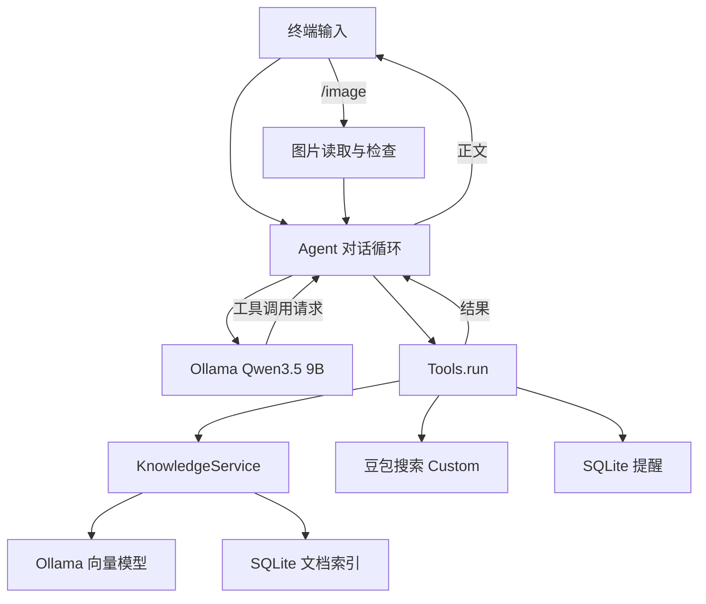

# JARVIS-M1 Phase 1：当前规划与代码讲解

更新日期：2026-11-02。当前采用 **Markdown 文档 RAG**，个人长期记忆已按用户要求移除。
之前的实施过程与验收记录保存在 [历史文档](phase1-history.md)，其中旧记忆工具和命令已停用。

## 项目范围

源码位于 Windows TableBot 目录，通过 `wsl.ps1` 在 WSL Ubuntu 中运行 Python。
应用只依赖 Python 标准库；Ollama 是独立服务，默认监听 `127.0.0.1:11434`。
当前包含中文对话、可编辑目录知识库、图片输入、豆包搜索和提醒。
默认使用“大肥鱼／鲸鱼娘”聊天人设，独立配置在根目录 [persona.md](../persona.md)，详见 [调整说明](persona.md)。
语音输入输出、打断、机器人硬件和远程管理界面留待后续。

| 模块 | 实现 | 当前行为 |
| --- | --- | --- |
| 对话 | `llm.py`、`agent.py` | Qwen3.5 9B，支持思考、工具循环、空回复恢复 |
| 文档 RAG | `knowledge.py`、`embeddings.py` | 扫描 Markdown，增量索引，纯向量检索，返回文件行号 |
| 图片 | `images.py` | 本地 PNG/JPEG，含中文与空格的 Windows/WSL 路径，会话内追问 |
| 联网 | `search.py` | 豆包搜索 Custom，返回网页来源及摘要 |
| 提醒 | `tools.py`、`storage.py` | 创建、查询、取消，到期在 CLI 输入前检查 |
| 持久化 | `storage.py` | SQLite 保存文档缓存、向量和提醒 |

## 启动与验收

在项目 PowerShell 中执行：

```powershell
.\wsl.ps1 -Action check
.\wsl.ps1
.\wsl.ps1 -Action test
.\wsl.ps1 -Action smoke
.\wsl.ps1 -Action kb-smoke
.\wsl.ps1 -Action vision-smoke
```

`smoke` 使用内存数据库验证聊天和提醒；`kb-smoke` 使用临时 Markdown 和内存数据库；
`vision-smoke` 使用临时测试图。它们不会修改用户原文或实际提醒。
`search-test` 则会发起一次真实豆包请求并消耗搜索额度，需主动运行。

| 命令 | 作用 |
| --- | --- |
| `/help` | 查看帮助 |
| `/image "路径" [问题]` | 发送本地图片；省略问题时描述图片 |
| `/kb` | 查看文档索引缓存统计 |
| `/kb-sync` | 增量同步 Markdown |
| `/reminders` | 直接列出当前用户的待提醒事项 |
| `/clear` | 清除当前文字和图片上下文 |
| `/quit` | 退出 |

PowerShell 还可使用 `-Action kb-index` 强制重建文档索引，`-Action pull` 下载配置中的模型。
旧的 `/memories`、`--reindex-memory`、`-Action index` 和 `rag-smoke` 已移除。

## 代码讲解

### 1. 启动流程与对象关系



`wsl.ps1` 将当前项目路径传给 Ubuntu，`scripts/wsl.sh` 固定工作目录并选择 Python 入口。
`__main__.py` 创建以下对象：

```python
store = Store(config.DB_PATH)
knowledge = KnowledgeService(
    store, EmbeddingClient(query_instruction=QUERY_INSTRUCTION))
agent = Agent(OllamaClient(), Tools(store, args.user, knowledge=knowledge))
```

文档服务和提醒共用数据库，但数据表各自独立。`--user` 只区分提醒记录，不是身份认证，
也不改变共享知识库的访问范围。

### 2. 工具调用如何触发

每次 `OllamaClient.chat()` 向 `/api/chat` 发送对话消息及 `TOOL_SCHEMAS`。
模型根据当前问题、上下文、系统规则和工具说明，返回正文或结构化 `tool_calls`。
`Agent` 解析工具名称与参数，调用 Python 的 `Tools.run()`，再把结果作为工具消息交回模型。
循环最多五轮；模型提出调用，实际数据库或网络操作由 Python 执行。

`agent.py` 在导入时读取根目录人设文件，将其与任务执行规则组合为系统提示词。
每次请求附上实际聊天模型名称。调整人设后需重启 CLI，现有工具和检索方式不变。

| 工具 | Python 执行位置 |
| --- | --- |
| `search_knowledge(query)` | `KnowledgeService.search()` |
| `search_web(query, time_range?)` | `DoubaoSearchClient.search()` |
| `create_reminder(message, due_at)` | 校验时间后调用 `Store.add_reminder()` |
| `list_reminders()` | `Store.list_reminders()` |
| `cancel_reminder(reminder_id)` | `Store.cancel_reminder()` |

没有保存、检索、列出或删除个人记忆的工具。旧工具名称会得到未知工具错误。
用户要求长期保存资料时，应自行编辑 `knowledge/`；模型没有写入文档的工具。

### 3. Markdown RAG

详细配置和使用方式见 [知识库说明](knowledge-base.md)。

1. `_scan()` 递归读取 UTF-8 Markdown，跳过隐藏项、符号链接及根目录之外的路径。
2. 用 SHA256 摘要、向量模型名和切块版本判断哪些文件需要更新。
3. `chunk_markdown()` 按标题分节，再按约 1000 字符切块，最多约 150 字符重叠，记录原文行号。
4. `EmbeddingClient` 调用本地 `/api/embed`，归一化文档向量；变化准备完成后再次核对文件快照。
5. 在一个事务中发布文件与片段的新增、替换和删除；失败时不发布部分更新。
6. 查询前同步，限定目录与模型，计算余弦相似度，过滤阈值并取前 K 块。
7. 模型根据片段回答，引用 `文件.md:L起始行-L结束行`。

没有关键词加权或文字匹配回退。相似度表示候选相关程度，不代表事实可信度。
本次没有命中不能证明整个知识库不存在相关资料。同步或向量服务错误应明确报告。

### 4. 短期上下文与图片

`Agent.history` 只在进程内存中保存当前会话。按完整轮次保留最多 30 条消息，
文字预算目标约 3000 字符；最新轮次过大时保留其用户问题和最终答复，成组移除工具消息。
它不是 token 硬上限，也不会自动生成摘要或写入长期资料。

`/image` 通过 `load_images()` 将本地 PNG/JPEG 编码进用户消息的 `images` 数组。
单张上限 10 MiB、1600 万像素，CLI 每次一张；进程历史最多保留最近两张。
base64 不计入文字预算，旧图移出会留下重新发送提示；文字历史窗口也可能使旧图片移出。
`/clear` 和退出会清除文字与图片上下文。详见 [图片说明](image-input.md)。

### 5. 生成预算与恢复

保留思考模式，默认上下文 32768、首次生成预算 8192、最大预算 16384、请求超时 300 秒。
收到 `done_reason=length` 时丢弃未完成响应，以相同输入和更大预算重试一次，
不执行截断响应里的工具调用。内部 `thinking` 不进入用户正文或后续历史。

空正文最多恢复一次。恢复时复用已经成功的同一工具调用结果，避免重复付费搜索或提醒写入。
生成仍失败时展示实际检索来源或错误。正常正文漏写完整知识库引用时，
`_knowledge_sources()` 补充本轮真实检索来源；该列表便于追溯，不代表已经逐条核验所有生成事实。

### 6. 联网策略与协议

当前通过提示词要求地点、人物、设定和项目介绍先查本地，明确联网和实时问题直接查网页。
这不是程序强制路由；本地返回相似片段但不足以回答、以及原作和二创的区分，仍需要进一步完善。
本轮移除个人记忆没有改变这套工具选择策略。

联网工具使用豆包搜索 Custom 独立 API，Key 为 `DOUBAO_SEARCH_API_KEY`，不是 Ollama Key。
搜索词 1–100 字符，每次最多五条结果，可按最近一天、周、月、年限制发布时间。
优先摘要，保留真实网页地址、站点及发布时间，单条内容最多约 1000 字符。
网络或权限、额度、限流、响应格式等错误明确返回，不自动重试付费请求。

### 7. 提醒与数据库

提醒需要明确的未来时间和时区，转换为 UTC 后保存。数据库按 `user_id` 隔离提醒，
状态为 `pending`、`cancelled` 或 `delivered`。`delivered` 仅表示到期提示已取出，不表示任务完成。
CLI 在每次等待输入前检查一次到期事项；停在输入框、程序退出或 WSL 停止时没有后台通知。

| 表 | 内容 |
| --- | --- |
| `knowledge_files` | 文档目录、相对路径、摘要、模型、切块版本、索引时间 |
| `knowledge_chunks` | 片段、标题层级、原文行号、JSON 向量，删除文件时级联清理 |
| `reminders` | 用户、事项、UTC 时间及状态 |

`Store._remove_legacy_memory()` 迁移旧数据库：开启 SQLite `secure_delete`，
先删除 `memory_embeddings`，再删除 `memories`，随后执行 `VACUUM` 清理数据库空闲页。
新数据库不创建这两张表。没有将旧个人记忆复制到 Markdown 或另建备份。

## 配置与文件

配置优先级为已有环境变量、`.env`、代码默认值。修改配置或代码后需退出旧 CLI 并重新启动。

| 配置 | 默认值 |
| --- | --- |
| `OLLAMA_MODEL` | `qwen3.5:9b` |
| `OLLAMA_URL` | `http://127.0.0.1:11434` |
| `OLLAMA_NUM_CTX` | `32768` |
| `OLLAMA_NUM_PREDICT` / `OLLAMA_MAX_NUM_PREDICT` | `8192` / `16384` |
| `OLLAMA_THINK` / `OLLAMA_CHAT_TIMEOUT` | `true` / `300` |
| `JARVIS_EMBED_MODEL` | `qwen3-embedding:0.6b` |
| `JARVIS_KNOWLEDGE_DIR` | `knowledge` |
| `JARVIS_KNOWLEDGE_TOP_K` / `JARVIS_KNOWLEDGE_MIN_SCORE` | `4` / `0.5` |
| `JARVIS_DB` / `JARVIS_TIMEZONE` | `data/jarvis.db` / `Asia/Tokyo` |
| `DOUBAO_SEARCH_API_KEY` | 用户自行填写 |

旧的 `JARVIS_MEMORY_*` 配置已移除。向量模型仍用于文档 RAG，不能删除或卸载。
主要源码入口为 [CLI](../jarvis/__main__.py)、[Agent](../jarvis/agent.py)、[工具分发](../jarvis/tools.py)、
[文档服务](../jarvis/knowledge.py)、[数据库](../jarvis/storage.py)、[模型请求](../jarvis/llm.py)。

## 本轮验收（2026-11-02）

- 85 项单元测试通过；原记忆测试移除，相关工具恢复测试改为提醒写入测试；旧记忆命令不会进入模型。
- 新增数据库迁移验证：旧记忆和向量清除，知识库和提醒保留，迁移可重复打开。
- 实际数据库删除一条个人记忆及其一条向量；42 个文档、297 个片段保持原样，提醒内容摘要不变。
- 数据库完整性和外键检查通过。
- 真实 Qwen 9B 的 `smoke`、`kb-smoke`、`vision-smoke` 均通过，提醒、文档检索及图片追问正常。
- 原句“展示记忆”未调用工具，模型明确说明当前没有个人长期记忆功能。

当前资料来源由用户编辑的 Markdown 和联网检索提供。普通聊天不再自动或通过工具积累个人长期记忆。
